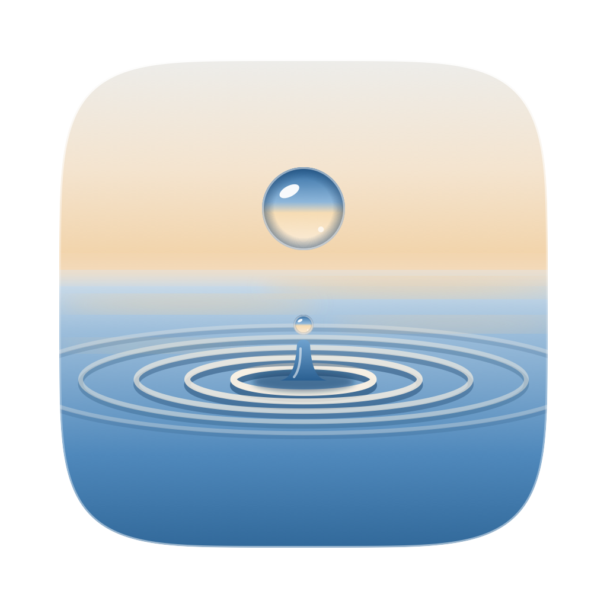

<p align="center">
  
</p>

# Nagi（凪）

作業中のデスクトップに、木漏れ日や雨、蛍などの自然の現象を描く macOS のメニューバーアプリです。キーボードやマウスの操作が止まると現れ、手を動かすと 1 秒以内に消えます。風（入力）が止むと海が凪ぐことから、Nagi と名付けました。

[English README](README.md)

スクリーンセーバーは長く席を離れたときにしか出ず、壁紙はウィンドウに隠れて見えません。Nagi は画像や動画を貼らず、作業中の画面の上に落ちる光や水を、その場で計算して描きます。止まっている時間が長くなるほど表現が深まり、同じ動きの繰り返しには見えないようにしています。

## ダウンロード

[Releases](https://github.com/izawa/Nagi/releases/latest) から DMG をダウンロードします。DMG を開いて Nagi を「アプリケーション」フォルダへドラッグし、起動すると、メニューバーにアイコンが出ます。動作環境は macOS 27 以降、Apple silicon の Mac です。

## エフェクト

一覧から好きなものをオンにします。複数をオンにすると重ねて出します。「1 つを選んで出す」をオンにすると、凪に入るときにオンのものから 1 つを選びます。前に選んでから 30 分以内なら、同じものを使います。凪の始まりに何も描かないもの（昼の蛍、月の無い夜の木漏れ日など）は選びません。

| エフェクト | 内容 | 画面収録の許可 |
|---|---|---|
| 木漏れ日 | 梢の隙間から落ちる日の光。時刻と太陽の高さに合わせて変わり、夜はごく弱い月明かりになる（設定で切れる） | 不要 |
| 雨 | ガラスにつく雨粒。粒が後ろの画面を屈折させて写す | 必要 |
| 水中の光 | 浅い水の底に揺れる光 | 不要 |
| 蛍 | 日が沈むと、画面の向こうの暗がりを蛍が飛び、ともっては消える。凪が深まるほど数が増え、明滅がそろっていく。初夏に多く、冬は少ない（日本の季節に合わせている） | 不要 |
| 宝石 | 動かしていないウィンドウの縁に育つ水晶などの結晶 | 必要 |
| 波紋 | 画面に張った浅い水に落ちる水滴の波紋（既定はオフ。下の注意を参照） | 必要 |

メニューバーのアイコンを押すとパネルが開きます。パネルでは、エフェクトの切り替え、「今すぐ見る」（待たずに、深まった凪を見る）、一時停止（1 時間、今日いっぱい、再開するまで）ができます。設定では、現れるまでの秒数、深まる速さ、全体の強さ、エフェクトごとの値を変えられます。

## 光過敏についての注意

どのエフェクトも、どの画素でも 1 秒間の点滅が 3 回以下になるように作っています。波紋はこの決まりの例外にしています。本物の水の波の速さで描くと、文字の上では 1 秒に 10 回を超えて明滅します。そのため既定ではオフにし、オンにするスイッチのそばに注意を出しています。光に敏感な方は波紋をオンにしないでください。

## プライバシー

- ネットワーク通信をしません。解析や計測のデータも送りません。
- 画面収録の許可を求めるのは、後ろの画面を写すエフェクト（雨、宝石、波紋）をオンにしたときと、設定の権限の画面でボタンを押したときだけです。取り込んだ画面は描画にだけ使い、ディスクにもログにも書きません。
- ウィンドウのタイトルやアプリ名を保持しません。
- アクセシビリティ、入力監視、位置情報の許可は求めません。手が止まったかどうかは、システムが持つ「最後の入力からの秒数」で判断します。

これらはソースコードで確かめられます。

## 動作環境

- macOS 27 以降
- Apple silicon の Mac

## ソースからビルドする

Swift 6.4 以降と、Xcode の Metal Toolchain が要ります。ビルドのスクリプトは Developer ID Application の証明書で署名します。

1. `Config/Local.xcconfig.example` を `Config/Local.xcconfig` に写し、`SIGN_IDENTITY` に証明書の名前か SHA-1 を書きます（`security find-identity -v -p codesigning` で一覧できます）。
2. ビルドします。

   ```bash
   scripts/build-app.sh
   ```

3. `build/Nagi.app` を開きます。

テストは、パッケージごとに `swift test --package-path <パッケージ>` で実行します（例: `Packages/NagiCore`）。

## リポジトリの構成

| 場所 | 内容 |
|---|---|
| `App/` | アプリ本体（メニューバーのパネル、設定） |
| `Packages/NagiKit` | エフェクトが使う API |
| `Packages/NagiCore` | 凪の検出、オーバーレイのウィンドウ、合成、画面の取り込みなど、エフェクトに共通の部分 |
| `Packages/Effects/` | エフェクトごとのパッケージと、開発用のエフェクトをまとめた `DebugEffects` |
| `Tools/nagi-render` | 時刻や背景を指定して、エフェクトを PNG に書き出す検証用のコマンド |
| `docs/` | 仕様書（`SPEC.md`）、決めたことの記録（`DECISIONS.md`）、マイルストーンごとの計画と記録。日本語のみ |

## ライセンス

[MIT](LICENSE)
