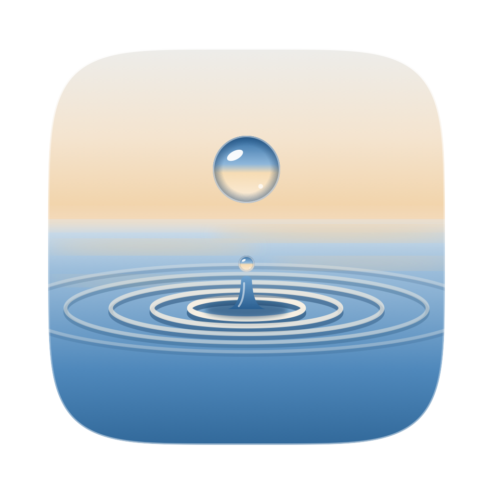

<p align="center">
  
</p>

# Nagi

A macOS menu-bar app that brings natural phenomena, such as sunlight through leaves and rain, onto your working desktop. It appears when you stop typing and moving the mouse, and fades within a second when you start again. *Nagi* (凪) is Japanese for the calm that settles on the sea when the wind (here, your input) dies down.

[日本語版 README](README.ja.md)

A screen saver only shows when you are away for a while, and a wallpaper stays hidden behind your windows. Nagi doesn't paste in pictures or videos: it computes light and water falling on the screen you are working on, as it happens. The longer you stay still, the deeper the scene grows, and it never settles into a visible loop.

## Download

Download the DMG from [Releases](https://github.com/izawa/Nagi/releases/latest). Open it, drag Nagi to your Applications folder, and launch it; its icon appears in the menu bar. Nagi needs macOS 27 or later on a Mac with Apple silicon.

## Effects

Turn on the ones you like. With several on, Nagi layers them. With **Show One at Random** on, it picks one of them when the calm begins, and keeps the same one if it picked less than 30 minutes ago.

| Effect | What it shows | Screen Recording permission |
|---|---|---|
| Komorebi | Sunlight falling through gaps in the canopy, following the time of day and the sun's height; at night, faint moonlight (can be turned off) | Not needed |
| Rain | Raindrops on glass, refracting the screen behind them | Needed |
| Light Under Water | Light rippling on the bottom of shallow water | Not needed |
| Fireflies | After sunset, fireflies fly in the dark beyond the screen, lighting up and dying away. More in early summer, fewer in winter | Not needed |
| Gems | Crystals growing along the edges of windows you leave in place | Needed |
| Ripples | Ripples from drops falling into a thin layer of water over the screen (off by default; see below) | Needed |

Click the menu-bar icon for a panel: switch effects, **See It Now** (see a deepened calm without waiting), and pause (for an hour, for the rest of today, or until you resume). Settings set how long to wait before it appears, how fast it deepens, its overall strength, and each effect's own values.

## Photosensitivity

Every effect is built so that no pixel flashes more than three times in any one second. Ripples are a deliberate exception: at the speed of real water waves, text under them flickers more than ten times a second. They are therefore off by default, and a notice sits next to their switch. If you are sensitive to flashing light, leave Ripples off.

## Privacy

- Nagi makes no network connections and sends no analytics or telemetry.
- It asks for Screen Recording only when you turn on an effect that shows the screen behind it (Rain, Gems, Ripples), or press the button for it in Settings. Captured frames are used only for drawing and are never written to disk or to logs.
- It doesn't keep window titles or app names.
- It doesn't ask for Accessibility, Input Monitoring or Location. Whether your hands are still comes from the system's count of seconds since the last input.

You can check all of this in the source code.

## Requirements

- macOS 27 or later
- A Mac with Apple silicon

## Building from source

You need Swift 6.4 or later and Xcode's Metal Toolchain. The build script signs with a Developer ID Application certificate.

1. Copy `Config/Local.xcconfig.example` to `Config/Local.xcconfig` and set `SIGN_IDENTITY` to the certificate's name or SHA-1 (list them with `security find-identity -v -p codesigning`).
2. Build:

   ```bash
   scripts/build-app.sh
   ```

3. Open `build/Nagi.app`.

Run the tests per package with `swift test --package-path <package>` (for example `Packages/NagiCore`).

## Repository layout

| Path | Contents |
|---|---|
| `App/` | The app: the menu-bar panel and settings |
| `Packages/NagiKit` | The API effects are written against |
| `Packages/NagiCore` | What all effects share: detecting the calm, overlay windows, compositing, screen capture |
| `Packages/Effects/` | One package per effect, plus `DebugEffects` with effects for development |
| `Tools/nagi-render` | A command that renders an effect to PNG for a given time, background and more, for checking the look |
| `docs/` | The specification (`SPEC.md`), the decision log (`DECISIONS.md`), and plans and logs per milestone, in Japanese only |

## License

[MIT](LICENSE)
